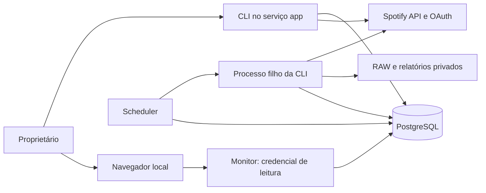
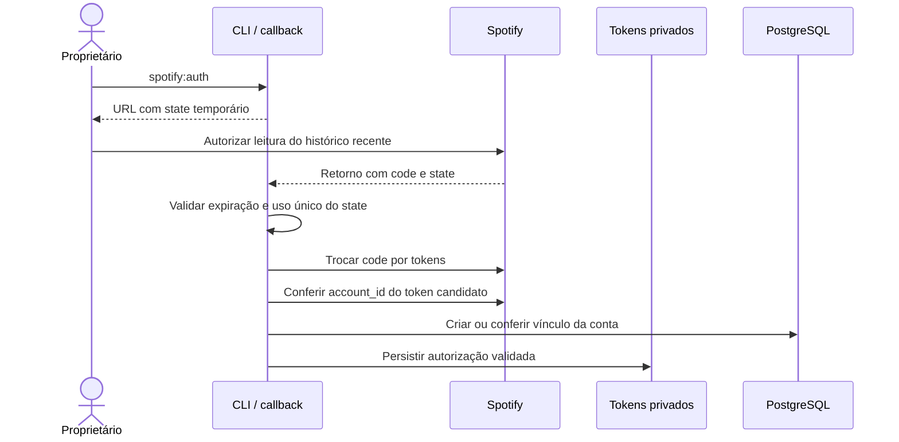
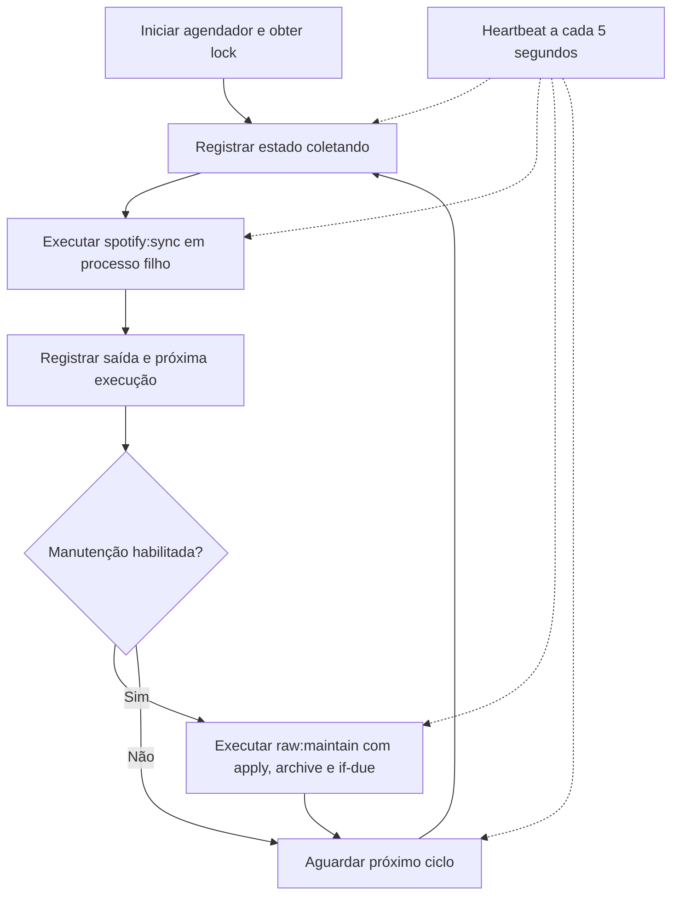
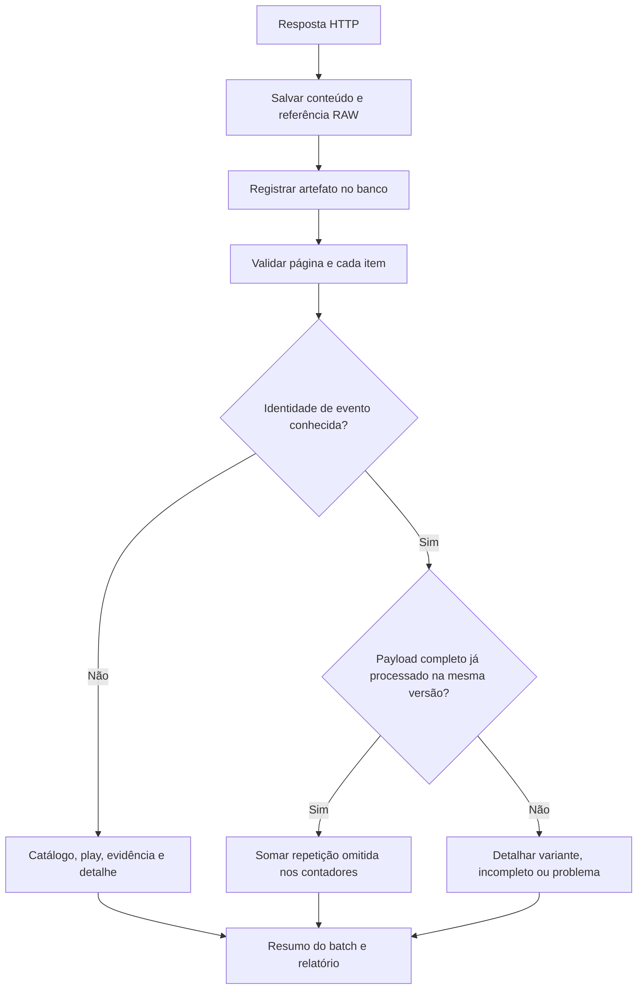
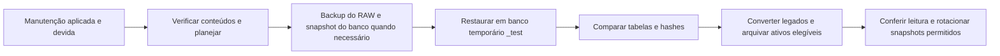
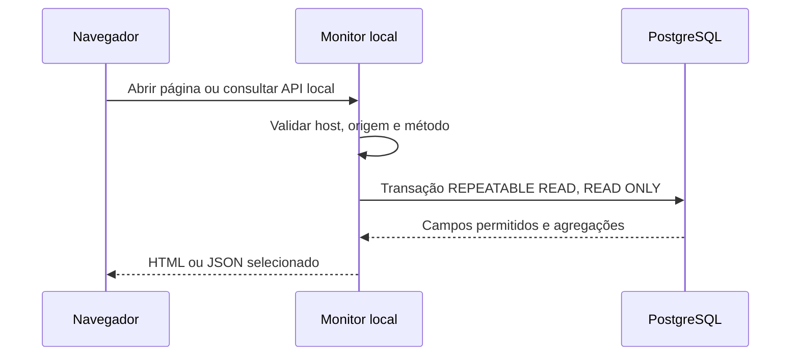

# Como o ListenLab funciona

[Índice](README.md) · [Início rápido](guias/inicio-rapido.md) · [Mapa do código](guias/desenvolvimento.md)

O ListenLab é um arquivo pessoal de dados musicais: consulta o histórico recente do Spotify, preserva as respostas originais, transforma os itens em eventos no PostgreSQL e permite consultar o resultado no navegador. Esta descrição foi conferida com o código local em **12/11/2026**. Estado de containers, quantidades e resultados de testes devem ser consultados ou executados no momento de uso.

## 1. As peças do sistema

| Serviço | Função | Como é usado |
| --- | --- | --- |
| `db` | PostgreSQL 17: eventos, catálogo, proveniência, auditoria e estado operacional | Permanente, em volume Docker persistente |
| `app` | PHP 8.4, Composer e ferramentas PostgreSQL | Comandos pontuais de administração, consulta e testes |
| `scheduler` | Inicia coleta e manutenção, publica heartbeat e próxima execução | Permanente enquanto a coleta estiver ligada |
| `monitor` | Servidor PHP com HTML/CSS/JavaScript e API local somente leitura | Páginas Análises, Dashboard e Testes |
| `callback` | Recebe o retorno OAuth do navegador | Temporário, durante a autorização |

As portas são publicadas apenas no loopback: monitor em `127.0.0.1:8787` por padrão e callback em `127.0.0.1:8888` quando ligado. O banco usa `db:5432` dentro do Docker; no Windows, a porta vem de `DB_PORT` — o modelo usa `5432` e esta instalação foi configurada com `15432`.

Não há fila, Redis ou build obrigatório de frontend. Fechar o navegador não interrompe o coletor. Docker, computador e banco precisam permanecer disponíveis.

## 2. Autorização e proteção da conta

A aplicação pede `user-read-recently-played` e usa Authorization Code com Client Secret protegido no backend. O `state` vence em dez minutos e só pode ser usado uma vez. O retorno também pode ser concluído pelo prompt oculto de `spotify:auth:complete`.

Os tokens ficam em `tokens/spotify.json`, fora do RAW musical. A renovação usa `expires_in`, um lock de arquivo e o refresh token. `invalid_grant` invalida a autorização local e exige novo OAuth. O aplicativo mantém a data original e uma previsão de reautorização em seis meses; o retorno efetivo do Spotify determina se a credencial é aceita.

Há uma conta por banco/diretório de dados. [AccountGuard.php](../src/Spotify/AccountGuard.php) consulta o perfil para obter `account_id` e guarda seu hash, sem arquivar o perfil como RAW musical. Um novo access token precisa ser verificado; o resultado é reutilizado para o mesmo token. Uma conta diferente é recusada antes de substituir a autorização ou aceitar seu histórico.

Um dataset anterior a essa proteção exige `spotify:account:bind` com o token que já o operava. O vínculo protege operações futuras, sem provar a titularidade dos RAW antigos. O procedimento completo está em [Instalação](guias/instalacao.md).

## 3. O ciclo automático

O [Scheduler](../src/Scheduling/Scheduler.php) obtém um advisory lock de sessão para manter um agendador por banco. Ao iniciar, executa uma coleta; depois espera o próximo ciclo. O padrão é `SYNC_INTERVAL_SECONDS=900`.

O intervalo conta desde o início do ciclo. Coleta ou manutenção demoradas podem atrasar o próximo. O heartbeat continua durante o processo filho e a espera. Com mais de vinte segundos sem atualização, o monitor não confirma atividade nem uma próxima execução.

O lock do agendador é diferente do lock da ingestão/manutenção. Um comando manual também passa pelas proteções do coletor. SIGTERM/SIGINT são tratados para encerrar o filho e registrar a parada; interrupção abrupta pode deixar um batch `running` e o heartbeat envelhece.

## 4. Uma coleta, passo a passo

A entrada é `php app spotify:sync`, implementada por [Console](../src/Console.php), [Collector](../src/Ingestion/Collector.php) e [Ingestor](../src/Ingestion/Ingestor.php).

1. Obter o lock de ingestão e abrir um `ingestion_batch`.
2. Obter/renovar o token e conferir sua conta.
3. Consultar `recently-played`, com limite padrão de 50 itens por página.
4. Preservar os bytes de cada resposta HTTP antes de interpretar status, JSON, retry ou itens.
5. Registrar o artefato com caminho, SHA-256, tamanho, recebimento e status HTTP.
6. Validar e processar cada item, com transação e lock por identidade.
7. Continuar pela paginação dentro do orçamento, registrar o motivo de parada e finalizar o batch.
8. Escrever o relatório privado em `storage/reports/batch-<id>.json`.

**Guardar primeiro, interpretar depois** permite investigar erros HTTP, JSON inválido e rejeições sem perder o conteúdo recebido. OAuth e perfil de conta usam armazenamento/controle próprios, fora desse RAW musical.

O sync segue `next` retornado, validando HTTPS, host, endpoint e parâmetros. Seu orçamento padrão é 20 páginas. O comando investigativo `spotify:probe` retrocede por `cursors.before`, com orçamento padrão de 100 páginas; também pode inserir eventos antigos ausentes. Nenhum dos dois inventa cursores a partir do maior timestamp local.

HTTP 401 permite uma renovação. `429` comum respeita `Retry-After` dentro do orçamento; uma espera excessiva encerra a tentativa sem encurtá-la. `QUOTA_EXCEEDED` encerra sem retry cego. [Integração Spotify](referencia/spotify-api.md).

## 5. Resposta, ocorrência, evidência e play

| Conceito | Significado |
| --- | --- |
| RAW / artefato | Um recebimento completo, inclusive resposta de erro ou lista vazia |
| Payload de item | O objeto de uma posição daquela resposta |
| Ocorrência detalhada | Linha de `ingestion_records` para novo evento, variante ou exceção |
| Evidência | Vínculo entre identidade da fonte, primeira ocorrência e play |
| Play | Um evento de reprodução normalizado |
| Catálogo | Faixas, artistas, álbuns e seus metadados conhecidos |

Exemplo fictício: uma consulta traz três eventos completos e outra traz os mesmos três com conteúdo conhecido. Ficam dois recebimentos RAW e três plays; a segunda execução registra três repetidos sem outras linhas individuais. Corpos idênticos byte a byte compartilham um objeto. Variantes de conteúdo, erros e dados incompletos continuam detalhados.

São três critérios diferentes: hash dos **bytes do corpo** para armazenamento; hash **canônico do item** para saber se o conteúdo já foi processado; chave de **identidade do evento** para impedir duplicação de plays.

A chave de evento combina versão, `played_at` em UTC e identidade da faixa: Spotify ID, depois URI, depois fingerprint conservador do payload. A mesma faixa em outro horário gera outra play. A API não fornece um identificador único do evento; dois eventos indistinguíveis na mesma precisão temporal podem coincidir na chave.

A constraint `UNIQUE(source_id, source_record_key)`, os locks e as transações protegem a atribuição. Nomes, ISRC ou proximidade temporal não unem versões ou fontes. Metadados são uma projeção atual: um novo evento pode atualizá-los, observações antigas não sobrescrevem as mais novas e uma repetição deduplicada não reescreve o catálogo.

Veja [Schema](referencia/schema.md) e [Auditoria enxuta](referencia/auditoria-enxuta.md) para os detalhes.

## 6. Armazenamento, backup e replay

| Local | Conteúdo |
| --- | --- |
| `storage/raw/` | Referências por recebimento e objetos ativos compartilhados |
| `storage/archive/objects/` | Conteúdos RAW únicos preservados no arquivo privado |
| `storage/archive/snapshots/` | Dumps, manifestos e provas de restauração |
| `storage/reports/` | Resumos de coletas e replays |
| `tokens/` | Estado OAuth e tokens privados |
| Volume PostgreSQL | Catálogo, plays, índice de artefatos, auditoria e estado operacional |

Os caminhos são configuráveis. Gzip é usado quando reduz o tamanho e não altera os bytes recuperados. Hash e tamanho de `raw_artifacts` descrevem o corpo original, não o arquivo de referência ou o gzip. `raw:read` recupera esses bytes e `raw:verify` confere sua integridade.

Filesystem e PostgreSQL não têm transação distribuída. Se o arquivo for publicado e o índice falhar, sobra um RAW órfão preservado; um crash também pode deixar `.partial`. Esses arquivos não são apagados automaticamente.

A tentativa aplicada é registrada antes da varredura. Com `--if-due`, outra tentativa fica bloqueada por 24 horas mesmo após falha. Sem dados ou trabalho que exija backup, a execução pode terminar sem um novo snapshot. Conversão de legados e liberação de conteúdo ativo exigem cobertura verificada no backup.

Por padrão, conteúdo elegível com 30 dias pode sair da pasta ativa, preservado no arquivo; conservam-se três snapshots completos verificados e todos os corpos RAW únicos. Arquivos desconhecidos, inclusive ocultos, impedem remover um snapshot. O arquivo no mesmo disco precisa de cópia privada externa para proteger contra perda física.

`ingest:replay ID` confere um artefato HTTP 200, cria outro batch e recebimento, preserva a data original de observação dos metadados e reaplica a normalização sem Spotify. A deduplicação reutiliza as plays conhecidas. A CLI não oferece rebuild destrutivo nem restauração sobre o banco principal. [Procedimentos de recuperação](referencia/raw-storage.md).

## 7. Do banco ao navegador

`/` redireciona para `/analytics`. [Análises](guias/analises.md) consulta ao abrir, aplicar filtros ou atualizar; usa plays e catálogo para rankings, métricas, comparações e distribuições. [Dashboard](guias/monitor.md), em `/dashboard`, consulta o banco a cada cinco segundos enquanto visível. `/tests` descreve a suíte sem executá-la.

O [router](../monitor/router.php) aceita GET/HEAD, valida a origem local e seleciona arquivos/rotas públicos. O monitor usa credencial PostgreSQL dedicada de leitura, recebe somente seu secret e monta `src`, `monitor` e `vendor` em leitura. Não carrega `.env` nem monta tokens, RAW, relatórios ou backups. O backend administrativo e o scheduler têm outro escopo de acesso.

Atualizar uma tela não chama o Spotify, inicia coleta ou manutenção. A interface não controla containers. O tema fica salvo no navegador. Outros processos locais não são autenticados por essa proteção de origem; a máquina precisa ser confiável e a aplicação continua pessoal e local.

## 8. Significado e limites dos resultados

| Estado da coleta | Interpretação |
| --- | --- |
| `completed`, saída 0 | Parada natural disponibilizada pela consulta |
| `partial`, saída 2 | Limite de paginação/progresso ou itens incompletos/rejeitados/para revisão |
| `failed`, saída 1 | Falha que encerrou o processamento |
| `running` antigo | Pode representar interrupção sem fechamento registrado |

`duration_ms` é duração de catálogo, não tempo ouvido. `ms_played`, `skipped` e `shuffle` permanecem `NULL` se a fonte não os fornece. Não há duração mínima de escuta na ingestão.

Timestamps ficam em UTC; filtros e exibição usam o timezone configurado. Dias sem registros podem refletir ausência de escuta ou lacuna de captura. Sucesso HTTP, primeiro/último evento e batch concluído não comprovam cobertura contínua ou vitalícia.

Importação Account/Extended, correspondência API/export, equivalência entre versões musicais, observação de reprodução atual e múltiplas contas ainda exigem implementação e decisões próprias. As fontes de export cadastradas no schema não implicam importadores existentes. [Pesquisas e evidências](README.md#pesquisas-e-histórico).
