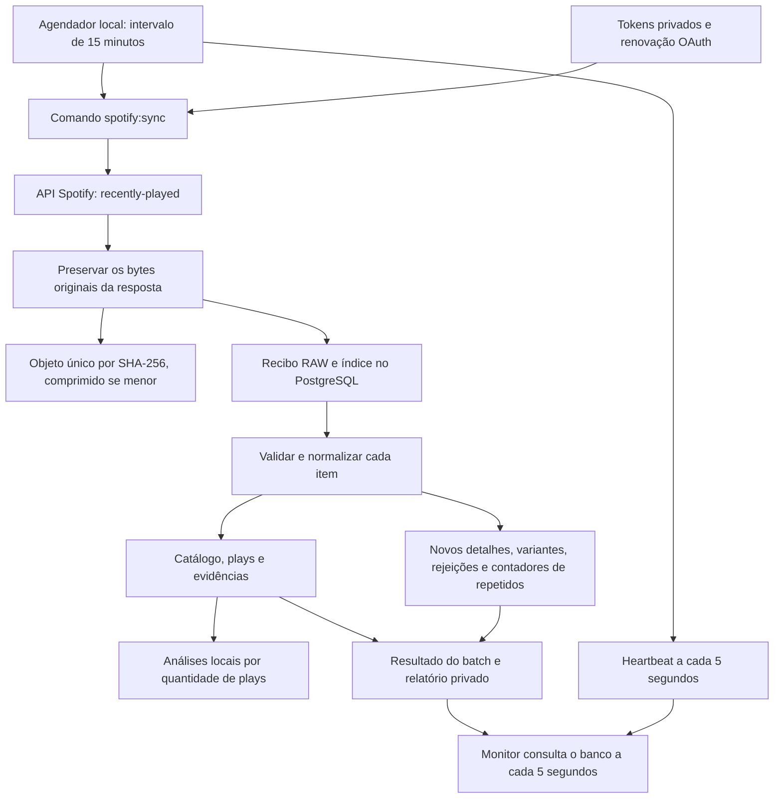

# Como o ListenLab funciona hoje

Descrição conferida no commit base `33ed9c8`, nas correções locais de 10/11/2026 e nas análises adicionadas em 11/11/2026. A [avaliação inicial](auditoria-2026-11-10.md) registra o diagnóstico; [as correções de segurança](correcoes-seguranca-2026-11-10.md) descrevem o estado aplicado e os avisos restantes.

O ListenLab é um arquivo pessoal de dados musicais. Ele consulta o histórico recente do Spotify, guarda a resposta original e transforma os eventos recebidos em tabelas PostgreSQL. O dashboard acompanha a operação dessa coleta; a tela de Análises apresenta rankings e distribuições dos eventos registrados. A importação dos arquivos Extended ainda não foi implementada.

## O caminho de uma coleta



O ponto central é a ordem: **guardar primeiro, interpretar depois**. Se o JSON estiver inválido, a API devolver um erro ou algum item não puder ser normalizado, os bytes recebidos continuam disponíveis para investigação.

## Os serviços locais

| Peça | Responsabilidade |
| --- | --- |
| `db` | PostgreSQL persistente, com eventos, catálogo, índices e auditoria |
| `scheduler` | Processo PHP que inicia as coletas e a manutenção periódica |
| `app` | Ambiente para comandos de administração, consulta, replay e testes |
| `monitor` | Servidor PHP e páginas HTML/CSS/JavaScript do painel local |
| `callback` | Recebe o retorno do Spotify durante a autorização OAuth |

A aplicação funciona em PHP 8.4 com PostgreSQL 17. Na instalação conferida, os containers usam PHP 8.4.27 e PostgreSQL 17.11. Não há fila, Redis, framework de frontend ou build Node obrigatório.

O monitor é acessível em `http://127.0.0.1:8787`. O banco está publicado em `127.0.0.1:15432` nesta instalação; dentro da rede Docker, a aplicação o acessa como `db:5432`. O callback usa `127.0.0.1:8888` quando seu serviço é iniciado.

O volume Docker mantém o banco entre reinicializações dos containers. Fechar a página do monitor não para o scheduler. O computador e o Docker precisam continuar ligados para haver novas coletas.

## Como a autorização funciona

O comando `spotify:auth` gera uma URL para o Spotify. O usuário autoriza apenas o scope `user-read-recently-played`. O retorno contém um código temporário e um `state`, que precisam corresponder à solicitação iniciada localmente.

O backend troca o código por tokens usando o segredo do aplicativo. O `state` vence em dez minutos e só pode ser usado uma vez. Os tokens ficam em `tokens/spotify.json`, fora do Git e das rotas públicas. As respostas de autenticação não são guardadas junto aos dados musicais.

Quando o access token está próximo do vencimento, a aplicação usa o refresh token para renová-lo. Um lock impede duas renovações simultâneas. Se o Spotify responder `invalid_grant`, a autorização inválida é removida e passa a ser necessária uma nova autorização pelo usuário.

O sistema também registra uma previsão de reautorização em seis meses. Essa data é um lembrete local; a aceitação efetiva do token depende do Spotify. Renovar o access token não reinicia a data original de autorização.

A versão atual trabalha com **uma conta por banco e diretório de dados**. O backend verifica o `account_id` estável do perfil e guarda apenas seu hash no banco. Uma reautorização de outra conta é recusada antes de substituir os tokens, e um token novo precisa corresponder à conta antes de consultar o histórico. Tokens já verificados reutilizam o resultado; um 401 permite uma renovação antes de verificar novamente. Para um histórico anterior a essa proteção, o comando `spotify:account:bind` vincula o token atual uma única vez. Isso já foi feito nesta instalação, sem mudar as chaves existentes.

## O que acontece a cada 15 minutos

O scheduler executa `php app spotify:sync`. O comando inicia um batch, consulta o endpoint `GET /v1/me/player/recently-played` e pede, por padrão, até 50 itens por página. Esse limite por requisição também consta na [referência oficial do Spotify](https://developer.spotify.com/documentation/web-api/reference/get-recently-played).

Cada resposta é preservada antes de interpretar status, JSON ou retries. Depois, os itens são validados: horário com timezone, identidade da faixa, tipos de campo, álbum, artistas e contexto. Os campos válidos alimentam o catálogo e as plays. Itens incompletos ou incompatíveis recebem estados e problemas próprios.

O sync segue a URL `next` fornecida pelo Spotify, após validar host, caminho e parâmetros. Ele tem um orçamento padrão de 20 páginas. O comando separado `spotify:probe` investiga páginas anteriores com `cursors.before`; também pode inserir eventos antigos que ainda estejam ausentes.

Em HTTP 401, o cliente tenta renovar o token uma vez. Em HTTP 429 comum, respeita `Retry-After` dentro do orçamento configurado. Uma espera acima desse orçamento encerra a tentativa com erro; ela não é encurtada. `QUOTA_EXCEEDED` encerra sem repetição cega. As respostas de erro também ficam preservadas.

Um lock PostgreSQL impede duas ingestões simultâneas. Outro lock impede dois schedulers no mesmo banco. O intervalo é contado a partir do início do ciclo; coletas ou manutenções demoradas podem atrasar a execução seguinte. Quinze minutos equivalem a aproximadamente 96 ciclos diários quando a operação não atrasa; paginação e retries podem acrescentar chamadas HTTP.

## Por que há mais respostas RAW do que plays

São três coisas diferentes:

| Conceito | Exemplo fictício |
| --- | --- |
| Resposta/artefato RAW | Uma consulta retornou uma lista de eventos |
| Ocorrência | Um evento apareceu na posição 0 dessa resposta |
| Play | A reprodução identificada como um evento do histórico |

Se uma consulta retorna três eventos completos e a seguinte retorna os mesmos três com conteúdo conhecido, ficam duas respostas RAW, três ocorrências detalhadas e três plays. A segunda execução registra três repetidos omitidos no resumo, sem outras linhas por item. Variantes de conteúdo, dados incompletos, erros e revisão continuam detalhados. Registros anteriores à mudança são preservados. [Política de auditoria enxuta](auditoria-enxuta.md). Se os corpos das respostas forem idênticos byte por byte, os dois recebimentos também compartilham um único objeto de conteúdo.

A chave de identidade da play combina uma versão da regra, o `played_at` convertido para UTC e a identidade da faixa. Usa o Spotify ID quando disponível, depois a URI; sem ambos, usa uma representação conservadora do payload. O nome da música não é usado para juntar eventos que têm uma identidade externa conhecida.

Ouvir a mesma faixa em outro horário gera outra play. Receber novamente a mesma faixa no mesmo instante reutiliza a evidência existente. A API não fornece um identificador único de evento: duas reproduções indistinguíveis no mesmo timestamp e precisão não podem ser separadas com certeza por essa chave.

A garantia contra duplicação fica no PostgreSQL, com constraints, locks e transações por item. Ela não depende apenas de uma consulta prévia feita pelo PHP ou de um marcador em memória.

## Como o banco está organizado

| Grupo | Tabelas e função |
| --- | --- |
| Origem e execuções | `data_sources` e `ingestion_batches` identificam a fonte e o resultado de cada execução |
| Evidência original | `raw_artifacts` registra caminho, hash, tamanho, status HTTP e recebimento |
| Ocorrências e problemas | `ingestion_records` guarda os detalhes necessários de eventos novos, variantes e exceções; repetições completas conhecidas ficam nos contadores do batch; `ingestion_issues` explica falhas |
| Catálogo | `tracks`, `albums`, `artists` e `track_artists` representam as entidades e a ordem dos artistas |
| Histórico | `plays` representa reproduções; `play_evidence` liga cada evento à fonte e à primeira ocorrência |
| Armazenamento | `raw_objects`, `raw_storage_refs` e `raw_storage_runs` registram conteúdo compartilhado, referências e manutenção |
| Agendador | `scheduler_runtime` informa intervalo, heartbeat, estado e próxima execução |

Uma faixa é uma entidade de catálogo; uma play é um evento. Remaster, versão ao vivo e outras faixas com IDs Spotify diferentes continuam separadas. Não há união automática por nome, ISRC ou proximidade de horários. Múltiplos artistas mantêm a ordem recebida.

Horários ficam armazenados em UTC e são exibidos no timezone configurado do monitor. `duration_ms` é a duração de catálogo da faixa. Ela não informa quanto tempo foi ouvido: `ms_played`, `skipped` e `shuffle` permanecem `NULL` quando a fonte não os fornece. Não há regra de duração mínima de reprodução nesta ingestão.

## RAW, compressão, backup e replay

O SHA-256 identifica os bytes exatos de cada resposta. Corpos iguais compartilham armazenamento; diferenças de espaços ou formatação produzem hashes diferentes. O conteúdo é comprimido em gzip quando isso reduz seu tamanho, e cada recebimento conserva uma referência própria.

`raw:verify` recupera os bytes e confere os hashes. `raw:read ID` recupera o corpo original pela CLI, mesmo que esteja comprimido ou arquivado. `ingest:replay ID` cria outra execução usando um RAW já registrado, sem consultar novamente o Spotify. A deduplicação evita criar as mesmas plays outra vez.

O índice RAW é gravado depois da publicação do arquivo. Se essa etapa de banco falhar, o arquivo pode ficar órfão e deve ser reconciliado. Não existe uma transação única entre filesystem e PostgreSQL. Arquivos parciais e órfãos não são apagados automaticamente.

A manutenção automática verifica se já houve tentativa registrada nas últimas 24 horas. Quando devida, cria um snapshot com conteúdos RAW e dump do schema, restaura o dump em um banco temporário terminado em `_test` e compara os dados das tabelas. Só após a verificação autoriza a conversão de arquivos antigos ou a remoção de cópias ativas que tenham cobertura no arquivo.

A política padrão permite arquivar conteúdos com pelo menos 30 dias e manter três snapshots completos do banco. Os corpos RAW únicos do arquivo não expiram. O banco, as ocorrências, as referências e os relatórios continuam crescendo.

`storage/archive` fica no mesmo projeto e disco. A recuperação depende de preservar os objetos, os snapshots e o índice. `.env`, tokens e relatórios precisam de backup privado separado. A cópia em outro meio continua necessária para falha física. A rotação agora enumera arquivos ocultos e preserva snapshots com entradas desconhecidas. Tentativas aplicadas são registradas antes da varredura RAW, de modo que uma corrupção inicial aparece como falha e respeita o intervalo diário de novas tentativas.

## O que o painel mostra

`/` redireciona para `/dashboard`. Essa página mostra estado do agendador, intervalo em execução, próxima coleta, último sync, contadores de ingestão, armazenamento e lista paginada de batches. Os detalhes mostram problemas e referências dos RAW, sem oferecer os corpos para download.

O scheduler grava um heartbeat a cada cinco segundos, inclusive enquanto o processo filho trabalha. Depois de vinte segundos sem sinal recente, o monitor deixa de confirmar atividade e próxima execução. A última coleta concluída, sozinha, não comprova que o agendador continua ligado.

A página consulta o banco a cada cinco segundos enquanto está visível. Atualizar a tela não chama o Spotify, não inicia manutenção e não altera o intervalo. Alterar o intervalo no `.env` exige recriar o scheduler para carregar o novo ambiente.

`/analytics` mostra rankings de faixas, artistas e álbuns, distribuições por hora/dia da semana e uma série diária, sempre pela contagem de `plays`. Filtros de calendário usam o fuso local; créditos de artistas não duplicam os demais totais. A tela consulta o banco ao abrir/aplicar filtros/atualizar, usando uma transação somente leitura e snapshot consistente. A credencial web pode ler as colunas selecionadas de data e catálogo, sem acesso a payloads ou contexto de escuta. [Critérios e limites das análises](analises.md).

`/tests` descreve a cobertura e fornece comandos para copiar. Abrir essa página **não executa testes**. Tema claro/escuro é salvo no navegador; não envolve tokens Spotify. As rotas atuais só aceitam GET/HEAD e selecionam explicitamente os metadados enviados ao frontend. O monitor usa credencial PostgreSQL exclusiva de leitura, monta só código e dependências em leitura e não tem acesso ao `.env`, tokens, RAW ou backups. Hosts inesperados e consultas de outras origens são bloqueados antes de conectar ao banco.

## Como interpretar o resultado de uma execução

| Resultado | Significado |
| --- | --- |
| `completed`, saída 0 | A execução chegou a uma parada natural da consulta disponibilizada pela API |
| `partial`, saída 2 | Orçamento/cursores impediram continuar ou houve itens incompletos/rejeitados |
| `failed`, saída 1 | Houve erro de coleta ou processamento que encerrou a execução |
| `running` antigo | Pode haver uma execução interrompida sem encerramento registrado |

`completed` não significa histórico vitalício completo. A API possui uma janela acessível e pode atrasar eventos. Se o computador ficar desligado ou eventos saírem dessa janela, uma coleta posterior pode não recuperá-los. O sistema preserva o que recebeu, sem inventar os intervalos ausentes.

Exports Account/Extended, matching entre fontes, equivalência entre versões musicais e múltiplas contas ainda dependem de implementação e decisões próprias. As fontes de export já aparecem no schema, mas isso não significa que seus importadores existam. Os rankings e distribuições locais foram implementados em 11/11/2026 conforme a [decisão 007](decisions/007-local-listening-analytics.md).

## Comandos úteis para conferir a instalação

```powershell
docker compose ps
docker compose run --no-deps --rm -T app php app spotify:auth:status
docker compose run --no-deps --rm -T app php app ingestion:list
docker compose run --no-deps --rm -T app php app raw:verify
docker compose run --no-deps --rm -T app composer test:all
docker compose run --no-deps --rm -T app composer audit --locked
```

Os testes usam dados sintéticos, arquivos temporários e banco separado do principal com nome terminado em `_test`. Eles não chamam o Spotify com os tokens reais. A suíte atual validou autenticação simulada, paginação, deduplicação, preservação e recuperação RAW, banco, scheduler e rotas HTTP. Os novos casos da auditoria demonstram por que a cobertura precisa evoluir junto com as garantias do sistema.
