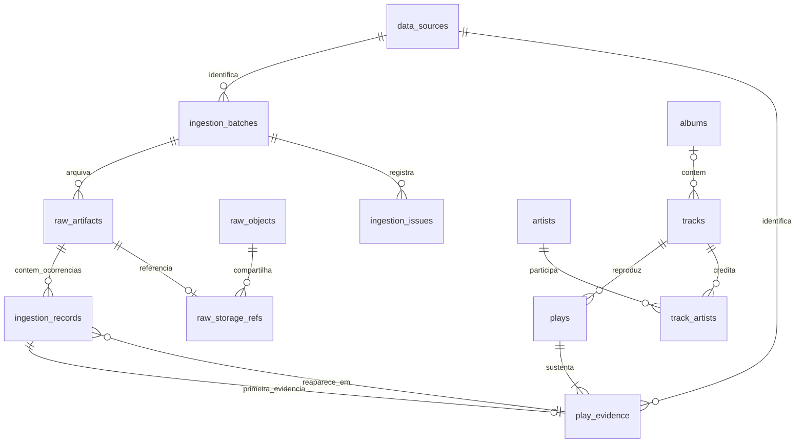

# Modelo de dados e migrations

[Índice](../README.md) · [Funcionamento](../funcionamento-atual.md) · [Auditoria enxuta](auditoria-enxuta.md)

O modelo corresponde às migrations 001–006. `schema_migrations` registra versão, checksum e data de aplicação. Fontes de export cadastradas não implicam importadores existentes.

As entidades usam IDs internos. IDs e URIs externos são atributos, com unicidade de `(provider, external_id)` para identidades conhecidas de catálogo. `external_id` pode ser `NULL`. Não há unicidade por nome, ISRC, álbum, `linked_from` ou URI local.

| Tabela | Responsabilidade |
| --- | --- |
| `schema_migrations` | Versão, SHA-256 e data de aplicação das migrations |
| `scheduler_runtime` | Instância, estado, intervalo efetivo, heartbeat e próxima execução |
| `data_sources` | `spotify_api`, `spotify_account_export` e `spotify_extended_export`, fontes distintas |
| `spotify_account_binding` | Um vínculo pessoal imutável por dataset, com hash do account_id e do access token verificado, sem guardar o perfil |
| `ingestion_batches` | Execução, operação, status, contadores e relatório da coleta |
| `raw_artifacts` | Caminho relativo ao RAW root, hash, tamanho, HTTP status, recebimento, endpoint e query; metadados append-only |
| `ingestion_records` | Detalhes de eventos novos, variantes e exceções por posição do RAW; hash, status, versão e evidência. Linhas legadas são preservadas; repetições completas conhecidas podem ficar só nos contadores do batch |
| `raw_objects` | Um corpo original por SHA-256; tamanho armazenado, encoding e localização ativa/arquivo |
| `raw_storage_refs` | Liga cada artefato ao conteúdo compartilhado e mede sua referência física |
| `raw_storage_runs` | Plano aplicado, resultado da manutenção, medidas e snapshot de backup verificado |
| `ingestion_issues` | Problema ligado ao batch, artefato e, quando possível, item |
| `artists`, `albums`, `tracks` | Catálogo conhecido, com campos tipados e identidades externas opcionais |
| `track_artists` | Relação N:N e ordem dos créditos |
| `plays` | Evento canônico com timestamp e semântica de origem; campos não informados em `NULL` |
| `play_evidence` | Liga play, fonte, chave de identidade e primeira ocorrência; várias fontes poderão sustentar uma play |

Uma repetição da API cria outro batch e recebimento RAW, reutilizando a evidência. Conteúdo completo conhecido na mesma versão pode ficar só nos contadores; variantes e exceções conservam detalhe. `UNIQUE(source_id, source_record_key)` é a garantia persistente de identidade. `UNIQUE(raw_artifact_id, item_index)` impede duas linhas detalhadas para a mesma posição de um artefato. O JSONB nunca substitui o arquivo original.

As migrations 003 e 004 acrescentam armazenamento compartilhado e referências de payload. `raw_artifacts` permanece append-only: seu hash e tamanho descrevem os bytes originais. A representação física pode ser uma referência a um objeto gzip, inclusive no arquivo privado. Novas ocorrências usam `payload_sha256`; o JSONB das ocorrências anteriores permanece intacto. A constraint exige JSONB ou hash. [Decisão 005](../decisions/005-shared-raw-storage.md).

A inserção de catálogo/play/evidência/vínculo do item é transacional por registro. Um lock por chave protege a atribuição e a constraint é a última defesa. O coletor usa também um advisory lock de sessão. Falhas de validação isolam o item; falhas sistêmicas encerram o batch. Dados válidos incompletos podem gerar `partially_processed`; mídias não suportadas geram `pending_review`. JSON válido com valores que JSONB não representa, como `\u0000`, fica no RAW e gera issue.

Timestamps de eventos, execução e observação são `TIMESTAMPTZ`. A API tem semântica `spotify_api_played_at`; não reinterpretamos como término da reprodução. A representação e o timezone originais continuam no RAW. Datas de álbum são texto com precisão separada, sem transformar `2024` artificialmente em `2024-01-01`.

O catálogo é uma projeção consolidada dos eventos normalizados. Um novo evento pode atualizar metadados conhecidos; uma repetição já deduplicada reutiliza seu catálogo. Observações antigas reaplicadas não sobrescrevem metadados mais novos. Metadados ausentes não apagam conhecimentos anteriores; uma relação de artistas desconhecida não é inventada. Tracks sem identidade externa são criadas por evento, sem heurística por nome, e reutilizadas quando a evidência se repete.

Os índices cobrem data/track das plays, artista na relação N:N, fonte/batch, artefatos, hashes, chaves e evidências. As análises consultam as tabelas existentes, sem agregados persistentes.

As migrations SQL são incrementais, transacionais, serializadas e verificadas por SHA-256. Não edite uma migration aplicada; adicione outra. Não existem migrações `down` destrutivas nesta entrega.

As migrations 005 e 006 complementam as proteções: o índice RAW recusa também TRUNCATE, e o vínculo da conta recusa troca de identidade, DELETE e TRUNCATE. As permissões de leitura do monitor são provisionadas separadamente com `monitor:provision`, sem conceder acesso aos payloads ou à tabela de vínculo. [Decisão 006](../decisions/006-local-security-boundaries.md).

As análises locais não acrescentam tabelas: agregam `plays` e o catálogo existente em snapshot somente leitura. O provisionamento concede apenas as colunas necessárias de `plays`, `tracks`, `artists`, `albums` e `track_artists`, além do acesso operacional existente. Payloads, contexto de escuta e vínculo privado continuam sem grant para a role web. [Decisão 007](../decisions/007-local-listening-analytics.md).

Tokens e state OAuth ficam em arquivos privados; o hash do vínculo de conta é persistido no banco. Há uma conta pessoal por dataset. Tabelas derivadas podem evoluir; auditoria e artefatos originais permanecem para reconstrução. Não há matching entre API e exports.

## Sequência das migrations

| Migration | Alteração |
| --- | --- |
| [001](../../migrations/001_initial.sql) | Fontes, batches, RAW, catálogo, plays, evidências, ocorrências e issues |
| [002](../../migrations/002_scheduler_monitor.sql) | Runtime do agendador |
| [003](../../migrations/003_raw_content_storage.sql) | Objetos, referências e manutenção |
| [004](../../migrations/004_storage_metrics_and_payload_refs.sql) | Métricas e referências de payload |
| [005](../../migrations/005_raw_truncate_protection.sql) | Proteção RAW contra TRUNCATE |
| [006](../../migrations/006_spotify_account_binding.sql) | Vínculo da conta |

Grants web são gerenciados por `monitor:provision`, fora das migrations. Confira [MonitorAccess.php](../../src/Monitoring/MonitorAccess.php); as análises também leem `albums.release_date` para décadas.
