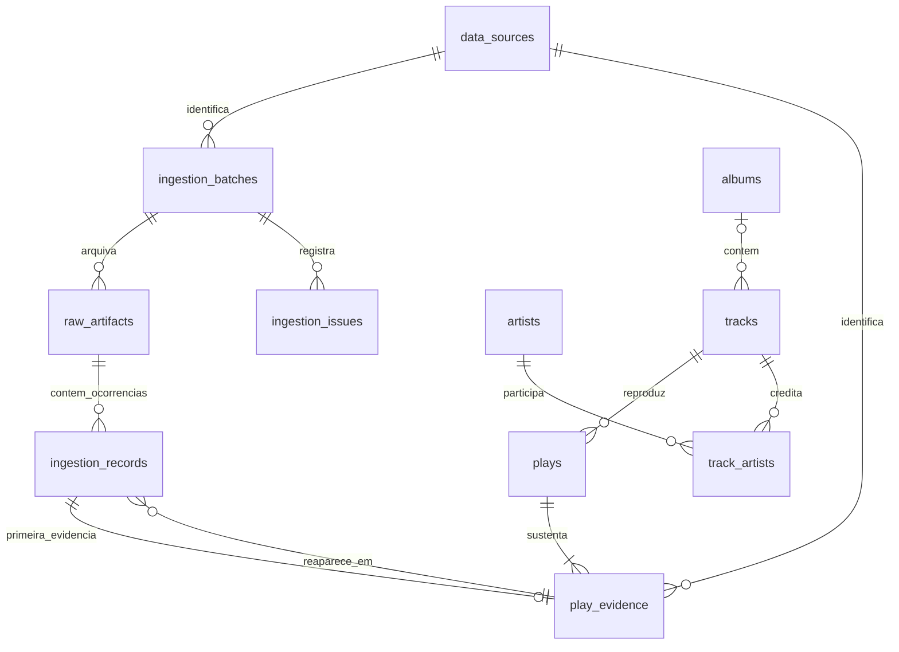

# Schema inicial

As entidades usam IDs internos. IDs e URIs externos são atributos, com unicidade de `(provider, external_id)` para identidades conhecidas de catálogo. `external_id` pode ser `NULL`. Não há unicidade por nome, ISRC, álbum, `linked_from` ou URI local.

| Tabela | Responsabilidade |
| --- | --- |
| `data_sources` | `spotify_api`, `spotify_account_export` e `spotify_extended_export`, fontes distintas |
| `ingestion_batches` | Execução, operação, status, contadores e relatório da coleta |
| `raw_artifacts` | Caminho relativo ao RAW root, hash, tamanho, HTTP status, recebimento, endpoint e query; metadados append-only |
| `ingestion_records` | Cada ocorrência em uma posição do array `items`; hash do payload (JSONB legado preservado), status, versão e evidência resultante |
| `raw_objects` | Um corpo original por SHA-256; tamanho armazenado, encoding e localização ativa/arquivo |
| `raw_storage_refs` | Liga cada artefato ao conteúdo compartilhado e mede sua referência física |
| `raw_storage_runs` | Plano aplicado, resultado da manutenção, medidas e snapshot de backup verificado |
| `ingestion_issues` | Problema ligado ao batch, artefato e, quando possível, item |
| `artists`, `albums`, `tracks` | Catálogo conhecido, com campos tipados e identidades externas opcionais |
| `track_artists` | Relação N:N e ordem dos créditos |
| `plays` | Evento canônico com timestamp e semântica de origem; campos não informados em `NULL` |
| `play_evidence` | Liga play, fonte, chave de identidade e primeira ocorrência; várias fontes poderão sustentar uma play |

Uma repetição da API cria outro batch/RAW/ocorrências, mas reutiliza a evidência. `UNIQUE(source_id, source_record_key)` é a garantia persistente. `UNIQUE(raw_artifact_id, item_index)` também permite repetir o processamento do mesmo artefato sem duplicar suas ocorrências. O JSONB nunca substitui o arquivo original.

As migrations 003 e 004 acrescentam armazenamento compartilhado e referências de payload. `raw_artifacts` permanece append-only: seu hash e tamanho descrevem os bytes originais. A representação física pode ser uma referência a um objeto gzip, inclusive no arquivo privado. Novas ocorrências usam `payload_sha256`; o JSONB das ocorrências anteriores permanece intacto. A constraint exige JSONB ou hash. [Decisão 005](decisions/005-shared-raw-storage.md).

A inserção de catálogo/play/evidência/vínculo do item é transacional por registro. Um lock por chave protege a atribuição e a constraint é a última defesa. O coletor usa também um advisory lock de sessão. Falhas de validação isolam o item; falhas sistêmicas encerram o batch. Dados válidos incompletos podem gerar `partially_processed`; mídias não suportadas geram `pending_review`. JSON válido com valores que JSONB não representa, como `\u0000`, fica no RAW e gera issue.

Timestamps de eventos, execução e observação são `TIMESTAMPTZ`. A API tem semântica `spotify_api_played_at`; não reinterpretamos como término da reprodução. A representação e o timezone originais continuam no RAW. Datas de álbum são texto com precisão separada, sem transformar `2024` artificialmente em `2024-01-01`.

O catálogo é uma projeção consolidada dos eventos normalizados. Um novo evento pode atualizar metadados conhecidos; uma repetição já deduplicada reutiliza seu catálogo. Observações antigas reaplicadas não sobrescrevem metadados mais novos. Metadados ausentes não apagam conhecimentos anteriores; uma relação de artistas desconhecida não é inventada. Tracks sem identidade externa são criadas por evento, sem heurística por nome, e reutilizadas quando a evidência se repete.

Os índices iniciais cobrem data/track das plays, artista na relação N:N, fonte/batch, artefatos, chaves e evidências. Não há otimizações analíticas prematuras.

As migrations SQL são incrementais, transacionais, serializadas e verificadas por SHA-256. Não edite uma migration aplicada; adicione outra. Não existem migrações `down` destrutivas nesta entrega.

O estado de autenticação fica separado do domínio, em arquivos privados. A versão atual pressupõe uma conta pessoal por dataset. Tabelas derivadas podem evoluir; auditoria e artefatos originais permanecem para reconstrução. Nenhum matching entre API e exports foi implementado.
